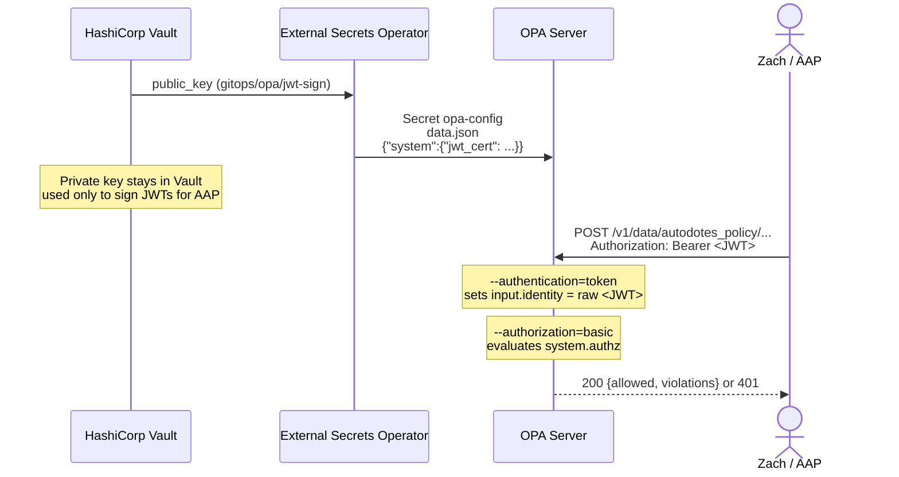

# OPA Bearer Token Authentication

This document covers the full setup for securing the OPA server's API with
RS256-signed JWT bearer tokens: generating the key pair, storing it in
Vault, how the Kubernetes manifests wire the public key in as `data.json`,
and how to mint a token for Ansible Automation Platform (AAP).

See the main [README's Security section](../README.md#security) for a
summary; this doc is the detailed reference.

## Contents

- [Overview](#overview)
- [PKI setup](#1-pki-setup)
- [Vault integration](#2-vault-integration)
- [OPA server configuration](#3-opa-server-configuration)
- [Minting a JWT for AAP](#4-minting-a-jwt-for-aap)
- [Rotation and revocation](#5-rotation-and-revocation)
- [Testing and troubleshooting](#6-testing-and-troubleshooting)

## Overview



OPA runs with two flags (see
[`k8s/base/deployment.yaml`](../k8s/base/deployment.yaml)). They do not both
verify the JWT. Signature and claim checks happen only in `system.authz`.

| Flag | Purpose |
|---|---|
| `--authentication=token` | Copies a `Authorization: Bearer <token>` value into `input.identity` as the raw token string. It does not parse the token or check its signature. If the header is missing or is not `Bearer <token>`, `input.identity` is left unset. On its own this flag does not accept or reject JWTs — that requires `--authorization=basic`. |
| `--authorization=basic` | Evaluates [`k8s/base/rego/system/authz.rego`](../k8s/base/rego/system/authz.rego) (`data.system.authz`) for every API request, including `GET /health`. The `authn` rule runs `io.jwt.decode_verify` on `input.identity` using the public key in `data.system.jwt_cert`. A denial is HTTP `401` with `{"code":"unauthorized","message":"request rejected by administrative policy"}`. |

`input.identity` exists only on that authorization input. It is not added to
the `input` document AAP sends for a policy decision, so bundle policies
under `policies/` never see the bearer token.

RS256 (asymmetric) is used instead of a shared secret so that OPA only ever
holds the **public** verification key. The **private** signing key never
leaves Vault, so a compromised OPA pod cannot mint new valid tokens.

## 1. PKI setup

Generate a 2048-bit (or stronger) RSA key pair dedicated to this
integration. Do this somewhere secure (not in this repo, not in CI) — the
private key only needs to touch Vault and whatever process mints tokens.

```sh
# Private key
openssl genrsa -out opa-aap.key 2048

# Public key (derived from the private key)
openssl rsa -in opa-aap.key -pubout -out opa-aap.pub

# Sanity check
openssl rsa -in opa-aap.key -check -noout
```

You should end up with:

- `opa-aap.key` — PEM-encoded RSA **private** key. Goes into Vault only. Used solely to sign JWTs.
- `opa-aap.pub` — PEM-encoded RSA **public** key. Goes into Vault, then External Secrets renders it into `data.json` as `data.system.jwt_cert` for `system.authz` to verify signatures.

Treat `opa-aap.key` as highly sensitive: anyone holding it can mint tokens
that `system.authz` will accept.

## 2. Vault integration

Store both keys under the Vault KV v2 path the `ExternalSecret` reads.
The cluster only fetches `public_key`:

```sh
vault kv put secret/gitops/opa/jwt-sign \
  public_key=@opa-aap.pub \
  private_key=@opa-aap.key
```

This matches [`k8s/base/external-secret.yaml`](../k8s/base/external-secret.yaml):

```yaml
data:
  - secretKey: public_key
    remoteRef:
      key: gitops/opa/jwt-sign
      property: public_key
```

`secret/` in the `vault kv` example is the KV v2 mount. The path after the
mount (`gitops/opa/jwt-sign`) is what the `ExternalSecret` `key` field
uses. If `vault-backend` uses a different mount, change the `vault kv` and
policy paths to match that mount; do not change the `ExternalSecret` key
unless the Vault path itself changes.

### Vault read policy (least privilege)

Scope the token/role the `vault-backend` `ClusterSecretStore` uses down to
read-only access on this one path:

```hcl
# opa-external-secrets-policy.hcl
path "secret/data/gitops/opa/jwt-sign" {
  capabilities = ["read"]
}
```

```sh
vault policy write opa-external-secrets opa-external-secrets-policy.hcl
```

Bind that policy to whichever auth method the `ClusterSecretStore` uses
(Kubernetes auth, AppRole, etc.) — this repo does not create the
`ClusterSecretStore` itself; it only assumes one named `vault-backend`
already exists with read access to this path. See the
[External Secrets Operator docs](https://external-secrets.io/latest/provider/hashicorp-vault/)
for provider-specific `ClusterSecretStore` configuration.

### Never pull the private key into the cluster

Only `public_key` is referenced by
[`k8s/base/external-secret.yaml`](../k8s/base/external-secret.yaml). Do not
add `private_key` to that `ExternalSecret` or any other cluster-facing
manifest — it only needs to exist in Vault and in whatever offline/CI
process mints tokens (see [Section 4](#4-minting-a-jwt-for-aap)).

## 3. OPA server configuration

The public key is OPA **data**, not OPA server config. There is no `keys:`
block. `io.jwt.decode_verify` reads `data.system.jwt_cert`.

| File | Role |
|---|---|
| [`k8s/base/config.example.yaml`](../k8s/base/config.example.yaml) | Non-secret reference copy of the bundle/polling config. **Not deployed.** The live copy is the `config.yaml` key rendered by the `ExternalSecret`. It has no JWT material. |
| [`k8s/base/external-secret.yaml`](../k8s/base/external-secret.yaml) | Renders Secret `opa-config` with two keys: `config.yaml` (bundle polling only) and `data.json` (`{"system":{"jwt_cert":"<pem>"}}`). |
| [`k8s/base/deployment.yaml`](../k8s/base/deployment.yaml) | Mounts only `config.yaml` from that Secret at `/etc/opa/config.yaml`. Projects the `opa-authz` ConfigMap and the Secret's `data.json` together at `/etc/opa/authz/`, and passes those two files to `opa run` with `--authentication=token --authorization=basic`. |
| [`k8s/base/rego/system/authz.rego`](../k8s/base/rego/system/authz.rego) | Package `system`. Verifies the bearer JWT, then allows or denies the request. |
| [`k8s/base/rego/system/data.example.json`](../k8s/base/rego/system/data.example.json) | Example shape of `data.json`. **Not deployed** and not listed in the Kustomize `configMapGenerator`. The live document is rendered from Vault. |

### How `data.json` becomes `data.system.jwt_cert`

The `ExternalSecret` template builds one JSON object. `toJson` escapes the
PEM (newlines become `\n`) so the value is a single JSON string:

```yaml
# k8s/base/external-secret.yaml (template data)
config.yaml: |
  services:
    github-pages:
      url: https://zjleblanc.github.io/autodotes-policy
  bundles:
    autodotes_policy:
      service: github-pages
      resource: bundles/autodotes_policy.bundle.tar.gz
      polling:
        min_delay_seconds: 30
        max_delay_seconds: 60

data.json: |
  {{ dict "system" (dict "jwt_cert" .public_key) | toJson }}
```

The rendered Secret key looks like
[`data.example.json`](../k8s/base/rego/system/data.example.json):

```json
{
  "system": {
    "jwt_cert": "-----BEGIN PUBLIC KEY-----\nMIIB...\n-----END PUBLIC KEY-----\n"
  }
}
```

`opa run` loads that file as a data document rooted at `data`. The
`system` key is what places the PEM at `data.system.jwt_cert`, next to the
`system` package rules. A bare PEM, or a JSON object without the `system`
wrapper, will not satisfy `authn`.

The Deployment mounts it beside the policy, and passes the two files
explicitly:

```yaml
args:
  - "run"
  - "--server"
  - "--config-file"
  - "/etc/opa/config.yaml"
  - "--authentication=token"
  - "--authorization=basic"
  - "/etc/opa/authz/authz.rego"
  - "/etc/opa/authz/data.json"
volumes:
  - name: config
    secret:
      secretName: opa-config
      items:
        - key: config.yaml
          path: config.yaml
  - name: authz
    projected:
      sources:
        - configMap:
            name: opa-authz
        - secret:
            name: opa-config
            items:
              - key: data.json
                path: data.json
```

Do not switch this to `opa run /etc/opa/authz/`. A Kubernetes projected
volume also contains `..data` and `..timestamp` copies; loading the
directory compiles those copies and fails with `multiple default rules
data.system.authz`.

`authz.rego` is the only file in the `opa-authz` ConfigMap
([`k8s/base/kustomization.yaml`](../k8s/base/kustomization.yaml)).
Kustomize content-hashes that ConfigMap, so a policy change rolls the pod
on `kubectl apply`. The cert does not live in that ConfigMap; rotating it
updates Secret `opa-config` key `data.json` (see
[Section 5](#5-rotation-and-revocation)).

### What `system.authz` checks

Default-deny, then three allows. `authn` is the JWT check: signature
against `data.system.jwt_cert`, and audience `opa.autodotes.com`.

```rego
authn if {
	[valid, _, _] := io.jwt.decode_verify(input.identity, {
		"cert": data.system.jwt_cert,
		"aud": "opa.autodotes.com",
	})
	valid == true
}

default authz := {"allow": false}

authz := {"allow": true} if {
	input.method == "GET"
	input.path == ["health"]
}

authz := {"allow": true} if {
	authn
	input.method == "POST"
	input.path[0] == "v1"
	count(input.path) >= 2
	input.path[1] == "data"
}

authz := {"allow": true} if {
	authn
	input.method == "GET"
	input.path == ["v1", "status"]
}
```

- `GET /health` does not require `authn`, so kubelet probes work without a
  bearer token. With `--authorization=basic`, `/health` still goes through
  this policy; the allow rule is what permits it.
- `POST /v1/data/...` (at least `POST /v1/data/<document>`) and
  `GET /v1/status` require a verified token.
- Everything else — policy upload/delete, data writes, `GET /v1/data`,
  `/v1/compile`, and so on — stays denied even when the JWT is valid.
- `io.jwt.decode_verify` compares `exp` and `nbf` to the current time when
  those claims are present, because the call does not pass a `time`
  constraint. It does not pin `alg`; mint tokens with RS256 so the
  signature matches this RSA public key. `iss` and `sub` are not checked.

The decision must be an object (`{"allow": true}` / `{"allow": false}`).
A bare boolean makes current OPA return `500` under `--authorization=basic`.

## 4. Minting a JWT for AAP

AAP's OPA integration sends a single static bearer token with every
request, so you mint one JWT and configure it once in AAP (rotating only
when you choose to, see [Section 5](#5-rotation-and-revocation)).

### Recommended claims

```json
{
  "sub": "aap",
  "iss": "autodotes",
  "aud": "opa.autodotes.com"
}
```

- `aud` must be `opa.autodotes.com`. `authn` rejects any other audience,
  including a missing `aud` claim.
- `sub` and `iss` are not checked today. They are still worth setting so a
  later policy change can pin the caller without re-minting blindly.
- Omit `exp` for a non-expiring token (simplest; revoke by rotating the
  key pair). If `exp` or `nbf` is set, `io.jwt.decode_verify` enforces it
  against the current time.

### Signing the token

Any JWT library that supports RS256 works. Example using Python's
[`PyJWT`](https://pyjwt.readthedocs.io/):

```sh
pip install pyjwt cryptography
```

```python
import jwt

with open("opa-aap.key") as f:
    private_key = f.read()

token = jwt.encode(
    {"sub": "aap", "iss": "autodotes", "aud": "opa.autodotes.com"},
    private_key,
    algorithm="RS256",
)

print(token)
```

Or with the [`jwt-cli`](https://github.com/mike-engel/jwt-cli) tool:

```sh
jwt encode --alg RS256 --rsa-private-key-file opa-aap.key \
  --sub aap --iss autodotes --aud opa.autodotes.com
```

### Configuring AAP

In AAP's policy-enforcement / OPA integration settings:

- **URL:** `https://opa.autodotes.com`
- **Bearer Token:** the JWT string produced above

AAP will send this token as `Authorization: Bearer <jwt>` on every policy
evaluation request. OPA places that string in `input.identity` for
`system.authz` only.

## 5. Rotation and revocation

Nothing in `--authentication=token` tracks or revokes tokens. A JWT keeps
working until `io.jwt.decode_verify` fails: the public key in
`data.system.jwt_cert` no longer matches, `aud` does not match, or `exp` /
`nbf` fails. Two ways to invalidate tokens:

1. **Rotate the key pair (immediate, revokes everything).** Generate a new
   RSA pair (Section 1), update `public_key` / `private_key` in Vault
   (Section 2), and mint a new token with the new private key. The
   `ExternalSecret` refreshes hourly (`refreshInterval: 1h` in
   [`k8s/base/external-secret.yaml`](../k8s/base/external-secret.yaml)) and
   re-renders `data.json`. Force an immediate refresh with:

   ```sh
   kubectl -n opa annotate externalsecret opa-config \
     force-sync=$(date +%s) --overwrite
   ```

   `opa run` watches `/etc/opa/authz/data.json`, so a projected-volume
   update reloads `data.system.jwt_cert` without a pod restart. Previously
   issued tokens then fail `authn`. If denials continue after the Secret's
   `data.json` shows the new key, restart the Deployment so the process
   re-reads the file. Update AAP with the newly minted token.

2. **Use `exp` claims (gradual, no action required).** Tokens stop
   verifying on their own at `exp`. Reissue and update AAP before expiry.

For routine hygiene, prefer periodic key rotation (option 1) on a schedule
(e.g. every 90 days) combined with `exp` claims as a backstop.

## 6. Testing and troubleshooting

OPA's basic authorizer returns **401** for every `system.authz` denial:
missing token, bad signature, wrong audience, expired `exp`, and a valid
token used on a path the policy does not allow. The status code does not
distinguish those cases. `GET /health` is the unauthenticated exception.

```sh
# GET /health is allowed by system.authz with no token
curl -sk https://opa.autodotes.com/health

# No token: input.identity is unset, authn fails, 401
curl -sk -X POST https://opa.autodotes.com/v1/data/autodotes_policy/deny \
  -d '{"input": {}}'

# Valid token on an allowed path: 200 (policy decision, which may still be allowed: false)
TOKEN="<jwt-from-section-4>"
curl -sk -X POST https://opa.autodotes.com/v1/data/autodotes_policy/deny \
  -H "Authorization: Bearer ${TOKEN}" \
  -d '{"input": {}}'

# Valid token on a path authz does not allow: still 401
# (for example, uploading a policy module)
curl -sk -X PUT https://opa.autodotes.com/v1/policies/test \
  -H "Authorization: Bearer ${TOKEN}" \
  --data-binary 'package test'
```

A `200` whose body is `{"allowed": false, "violations": [...]}` means the
bearer token was accepted and the bundle policy denied the job. That is
not an authentication failure.

If requests unexpectedly fail:

```sh
# config.yaml is bundles only — it should not contain a keys: block
kubectl -n opa get secret opa-config -o jsonpath='{.data.config\.yaml}' | base64 -d

# data.json is the verification key: {"system":{"jwt_cert":"-----BEGIN PUBLIC KEY-----\n..."}}
kubectl -n opa get secret opa-config -o jsonpath='{.data.data\.json}' | base64 -d

kubectl -n opa describe externalsecret opa-config

kubectl -n opa logs deploy/opa
```

Common causes of unexpected `401`s:

- The `Authorization` header is missing or is not `Bearer <token>`, so
  `input.identity` is unset.
- The JWT was signed with a different key than `public_key` currently in
  Vault, or `data.json` has not refreshed since a rotation.
- `aud` is not `opa.autodotes.com`, or `exp` / `nbf` fails.
- The method and path are not one of the allows in
  [`k8s/base/rego/system/authz.rego`](../k8s/base/rego/system/authz.rego).
- `data.json` is missing the `system.jwt_cert` string (bad template, or
  the projected volume did not mount the Secret key). `authn` cannot
  succeed without it.

A `500` from an authorization decision usually means `data.system.authz`
was undefined or was not an object with an `allow` field — for example
OPA loaded a second copy of the policy (`multiple default rules
data.system.authz`) because the authz directory was passed instead of the
two files.
